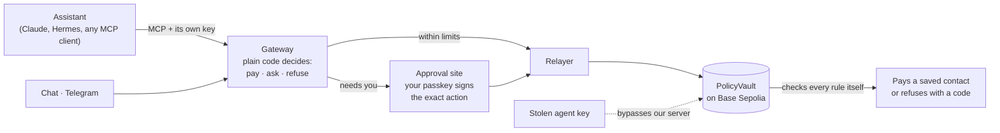

<div align="center">


# Nudge

**Let your AI assistants pay. Only within your rules.**

Nudge is a wallet where Claude and your other assistants pay your saved contacts within limits you set, enforced by a contract on Base Sepolia even if an assistant's key is stolen. Anything bigger, and any rule you loosen, waits for your passkey.

[](https://github.com/laksh-ya/nudge/actions/workflows/ci.yml)


[**Live app**](https://nudge-wallet.vercel.app) · [**Proof on-chain**](https://nudge-wallet.vercel.app/proof) · [**Connect your agent (MCP)**](https://nudge-wallet.vercel.app/agents/docs) · [**Telegram**](https://t.me/heynudge_bot) · [Docs](docs/README.md) · [Brand](docs/BRAND.md)


</div>

> FinTechathon 2026 entry, Topic F (Agent Wallet). Testnet prototype: wallet payments use test dollars (tUSD) with no value; bank feeds and family transfers are simulated.

<div align="center">

| **99 / 99** | **8 / 8** | **570** | **3 / 3** |
|:---:|:---:|:---:|:---:|
| cited Base Sepolia transactions re-verified from a public node | end-to-end tests on Base Sepolia through the real backend | contract, backend and domain tests passing | race and lost-receipt tests: never over the limit, never paid twice |

</div>

## Judge's tour, three minutes

| | Open | What you'll see |
|---|---|---|
| 1 | [**Try the demo**](https://nudge-wallet.vercel.app) | A private sandbox in your browser: assistants, limits, contacts, a chat that pays |
| 2 | [**Proof page**](https://nudge-wallet.vercel.app/proof) | Every payment, hold, approval and refusal decoded live from Base Sepolia, not from our server |
| 3 | [**A stolen key, refused**](https://sepolia.basescan.org/tx/0x0563fdacf54f69d18a35f7d5a0a4668bd881781b2635c565df17ecf8eb9c80bd) | An agent key used behind our back: the vault refuses it (code 2003), and freezes it on the fifth try |
| 4 | [**Connect your own AI**](https://nudge-wallet.vercel.app/agents/docs) | Claude Code, Cursor or any MCP client gets its own key and starts read-only |
| 5 | [**Approve on your phone**](https://nudge-approve.vercel.app) | The passkey signs the exact amount and payee; nothing else can loosen a rule |
| 6 | [**Telegram**](https://t.me/heynudge_bot) · [**Brand**](https://nudge-wallet.vercel.app/brand) | Approvals and reminders in chat; the cast and the rules behind the look |

## Why

Giving an AI assistant your card is all or nothing. A prompt injection, a confused model, or a leaked API key can spend everything. Nudge gives your AI an allowance instead: a small on-chain vault sits between your assistants and your money.

- **Small payments just happen.** Each assistant has its own key, per-payment and daily limits, and may pay only contacts you saved.
- **Big or unusual ones wait for you.** Over the limit, a new contact, or anything that loosens a rule needs your passkey, signed over the exact action. Loosening also waits out a delay you can cancel.
- **A stolen key can't drain it.** The vault checks every rule itself. Five refusals and it freezes that key on its own. A guardian (someone you trust) can stop held payments and freeze, but can never pay or loosen.

## Try it in two minutes

1. Open the [live app](https://nudge-wallet.vercel.app) and choose **Try the demo**. You get a private sandbox with sample accounts, bills and connected assistants.
2. **Wallet → Put this wallet on-chain.** Create a passkey on your phone (scan the QR) or laptop, then type the six-digit code it shows. Your own vault deploys in about a minute.
3. Ask the assistant to pay Blue Tokai $3 (it goes through), then more than Claude's limit (it waits for your passkey). Open the approval link to see exactly what you'd sign.
4. Try to break it: freeze an assistant, raise a limit, remove a contact, withdraw, or connect your own assistant over MCP.

The team's account, with a phone-passkey vault and recorded history, opens read-only at [`/judge`](https://nudge-wallet.vercel.app/judge) with the judge key.

## How it works



The model never decides what's allowed: the gateway is ordinary code, and the vault re-checks everything on-chain, so even a request that skips our server is held to the same rules. Details in [docs/ARCHITECTURE.md](docs/ARCHITECTURE.md).

### A payment's journey

1. **An assistant asks.** Claude, Hermes or any MCP client, or you in chat or Telegram, each with its own key.
2. **Plain code decides.** The gateway checks that assistant's limits, its contacts, holds and freezes, then pays, asks you, or refuses. A model never makes this call.
3. **You decide the big ones.** Anything over a limit, to someone new, or loosening a rule opens the approval site, where your passkey signs the exact amount and payee.
4. **It's sent once.** The relayer sends one transaction at a time per key and settles lost receipts from the chain, so nothing is paid twice.
5. **The vault has the last word.** PolicyVault on Base Sepolia re-checks every rule, so a key used behind our back gets the same answer.
6. **Anyone can check.** Receipts and AP2 mandates verify against the chain; the proof page reads them live.

## Features

| Feature | Why it matters |
|---|---|
| **A key and limits per assistant** | Claude, ChatGPT, Hermes and others each get their own key, per-payment and daily caps, and a list of who they may pay |
| **Passkey for anything bigger** | Over a limit, a new contact or any loosened rule needs your passkey over the exact action; loosening then waits a delay you can cancel |
| **Stolen-key proof** | The vault enforces every rule on-chain; five refusals freeze that key on their own |
| **Freeze in one tap** | From the app or a chat message; unfreezing needs the passkey and the vault's delay |
| **Family guardian** | Someone you trust sees held payments and can stop them or freeze, but can never pay or loosen |
| **Any AI over MCP** | A public, permission-filtered MCP server; read-only by default |
| **AP2 mandates** | Intent, Cart and Payment mandates from the vault, verifiable by anyone on Base Sepolia |
| **Pay and withdraw yourself** | From the Wallet screen, signed by your passkey; withdrawals wait the delay |
| **A chat that won't be fooled** | Corrections cancel the old request; questions, quoted text and scam messages never become payments |
| **Every assistant has a face** | Characters show at a glance who's paying, waiting or caught ([brand](docs/BRAND.md)) |

## What's live

| Area | State |
|---|---|
| Vault payments: within limits, held, owner-approved, refused | **Live** on Base Sepolia (tUSD) |
| Passkey approval and enrolment | **Live**: WebAuthn on a separate approval site, verified by the contract |
| Pay a contact and withdraw from the Wallet screen | **Live**, signed by the passkey; withdrawals wait the vault's delay |
| Freeze, unfreeze, disconnect, limits, contacts | **Live**: each acts on the vault and is read back |
| Outside assistants over MCP | **Live**: per-assistant bearer keys, permission-filtered tools, [public docs](https://nudge-wallet.vercel.app/agents/docs) |
| Family guardian | **Live**: sees held payments, can stop them or freeze; never pays or loosens |
| AP2 mandates (Intent, Cart, Payment) | **Live**: produced from the vault and verifiable by anyone against Base Sepolia |
| Built-in assistant and Telegram | **Live**: rule-based on the deployment; approvals and reminders in chat and on Telegram ([@heynudge_bot](https://t.me/heynudge_bot)), outside quiet hours |
| Bank feeds, family transfers | Simulated (statement import from CSV, Excel and PDF is real) |
| MCP OAuth, WhatsApp | Not yet |

## Connect your own assistant

Agents → **Connect an assistant** → copy the key (shown once). For Claude Code:

```bash
claude mcp add --transport http nudge https://ceaseless-raven-960.convex.site/mcp --header "Authorization: Bearer aw_…"
```

A new assistant starts read-only; turn on *Prepare payments* or *Pay within limits* on its card. Tools, outcomes and refusal codes: [Connect your AI agent](https://nudge-wallet.vercel.app/agents/docs).

## Tests and evidence

| Suite | What it covers | Result |
|---|---|---|
| Contracts (Foundry) | Unit, fuzz and invariant tests, plus the review's adversarial cases | 150 passing |
| Backend (Vitest, convex-test) | Gateway decisions, approvals, contacts, MCP, chat intents, reminders, guardian | 357 passing |
| Domain (Vitest) | Encoding, signatures, statements, proof decoding | 63 passing |
| End to end on Base Sepolia | The real backend and a fresh vault per run: pay, hold, approve, stolen key, freeze, pay and withdraw | [`packages/domain/test`](packages/domain/test) |
| Attacks and evals | Contract attacks, live attacks on the deployed app, prompt injection with real models | [`evals/`](evals/README.md) |

```bash
pnpm install && pnpm test        # contracts, backend and domain
bash scripts/verify-evidence.sh  # re-checks every cited transaction on Base Sepolia
```

Every on-chain claim links to a transaction: [docs/EVIDENCE.md](docs/EVIDENCE.md). How each suite runs, and what isn't covered: [docs/TESTING.md](docs/TESTING.md).

| Contract (Base Sepolia) | Address |
|---|---|
| VaultFactory v3 | [`0xF0D906bd…DA95e`](https://sepolia.basescan.org/address/0xF0D906bdec522087992EA711710Ee60F2a8DA95e) |
| TestUSD (tUSD) | [`0xB0ee0123…7D932`](https://sepolia.basescan.org/address/0xB0ee01235A8e7903519B029c1530332f5847D932) |
| Judge account vault (v3) | [`0x85EFA734…900a8`](https://sepolia.basescan.org/address/0x85EFA7346e408DB2c28D01bA0De82E77F01900a8) |

## Security

The claim, who can do what, the controls with their evidence, and the known risks are in [docs/SECURITY.md](docs/SECURITY.md). In short: the owner's passkey is the only thing that can loosen a rule; the relayer and guardian keys can only tighten; agent keys are sealed with AES-256-GCM and capped by the contract; there's no upgradeable proxy or admin key. Please report vulnerabilities as described there.

## Brand

Nudge is the friend who taps you on the shoulder before your AI spends something it shouldn't. Every assistant gets a face, and the face says what's happening: paid, held, waiting for your passkey, refused, frozen. The logo, the cast of characters, colour, type, voice and motion are one package, [`packages/brand`](packages/brand), used by both apps; the rules are in [docs/BRAND.md](docs/BRAND.md) and the living sheet is at [`/brand`](https://nudge-wallet.vercel.app/brand).


## Tech stack

| Layer | Stack |
|---|---|
| **Chain** | Base Sepolia (84532), test dollars (tUSD) |
| **Contracts** | Solidity 0.8.30 · Foundry (fuzz and invariant tests) · OpenZeppelin WebAuthn / P-256 |
| **Backend** | Convex: transactional mutations, scheduler, crons, HTTP actions (MCP, Telegram) |
| **Web** | Next.js 16 · TypeScript · Tailwind CSS 4 · Clerk sign-in |
| **Approval site** | Vite + React on its own domain, strict CSP, browser WebAuthn with no library |
| **Chain client** | viem |
| **Assistant** | Claude (Anthropic SDK) with the same tools as MCP; rule-based when no key is set |
| **Brand** | `packages/brand`: characters, tokens, logo, dot art, exported SVGs |

## Project structure

```text
apps/web              Next.js app: dashboard, wallet, agents, chat, onboarding
apps/approve          Approval site (Vite, separate host): the only place the passkey signs
packages/backend      Convex: gateway, MCP server, relayer, chain reads, assistant, reminders
packages/domain       Shared logic: vault encoding, WebAuthn, mandates, money, statements
packages/brand        Nudge's logo, characters, tokens, dot art and exported SVGs
packages/domain/test  Unit, Base Sepolia end-to-end and eval suites
contracts             Solidity (Foundry): PolicyVault, VaultFactory, TestUSD and their tests
evals                 Attack, injection and task results
docs                  Architecture, security, testing, evidence, development, brand
```

## Run it locally

```bash
pnpm install
pnpm --dir packages/backend dev   # Convex dev deployment
pnpm --dir apps/web dev           # http://localhost:3000
pnpm --dir apps/approve dev       # http://localhost:3001
```

Environment variables, deploying your own contracts, Telegram and the stack decisions: [docs/DEVELOPMENT.md](docs/DEVELOPMENT.md).

## Built with

TypeScript · Next.js · Vite · Convex · Solidity and Foundry · OpenZeppelin WebAuthn/P-256 · viem · Clerk · Anthropic Claude · Base Sepolia
