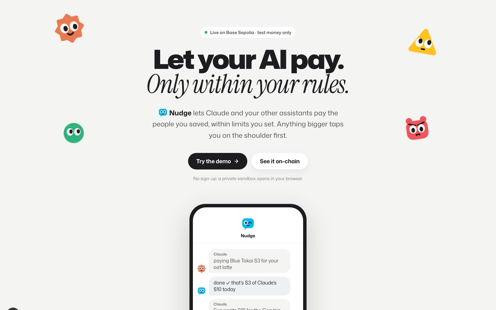
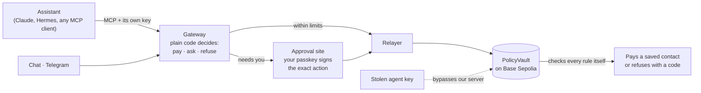
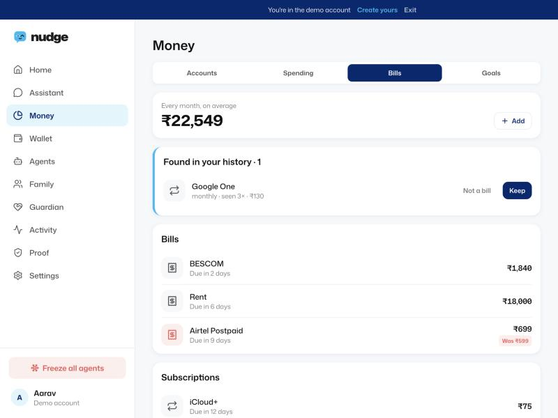
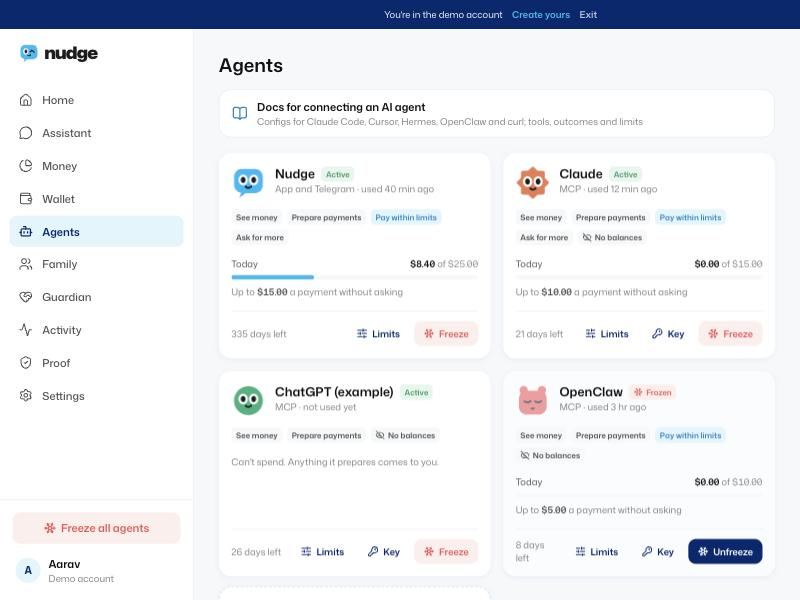
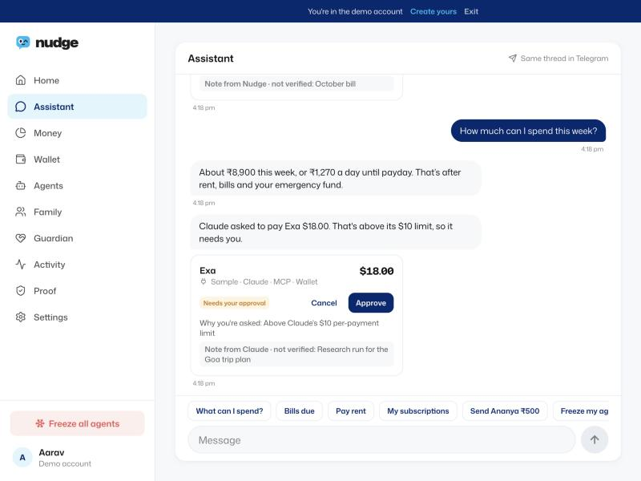
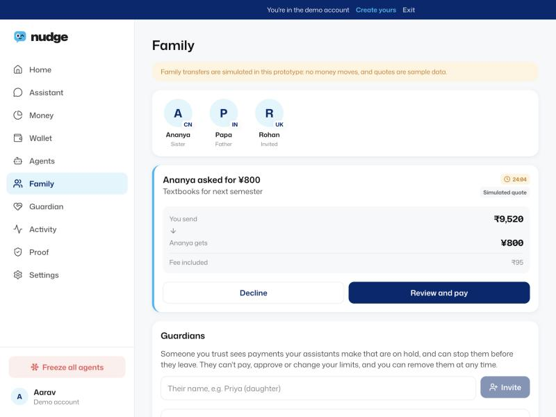
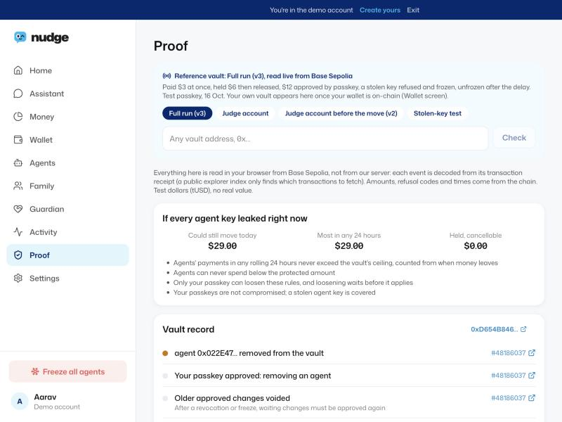

<div align="center">


# Nudge

**Let your AI pay. Only within your rules!!**

Nudge is a wallet your AI assistants can pay from, on a leash you set. Small payments go through on their own; anything bigger waits for your passkey; and a contract on Base Sepolia enforces every rule, even if an assistant's key is stolen!!

[](https://github.com/laksh-ya/nudge/actions/workflows/ci.yml)


[**Live app**](https://nudge-wallet.vercel.app) · [**Proof on-chain**](https://nudge-wallet.vercel.app/proof) · [**Connect your agent**](https://nudge-wallet.vercel.app/agents/docs) · [**Telegram**](https://t.me/heynudge_bot) · [Docs](docs/README.md)



| **99 / 99** | **8 / 8** | **641** | **3 / 3** |
|:---:|:---:|:---:|:---:|
| cited Base Sepolia transactions re-verified from a public node | end-to-end tests on Base Sepolia through the real backend | contract, backend and domain tests passing | race and lost-receipt tests: never over the limit, never paid twice |

</div>

> FinTechathon 2026, Topic F (Agent Wallet). Testnet prototype: wallet payments use test dollars (tUSD) with no value. Bank feeds and family transfers are simulated and labelled as such in the app.

## Why

Giving an AI assistant your card is all or nothing. One prompt injection, one confused model or one leaked API key can spend everything. Nudge gives each assistant an **allowance instead of your card**: its own key, its own limits, and a list of people it may pay. The rules live in a contract, not in a prompt, so they hold even when the model or our server doesn't.

## How it works



1. **An assistant asks:** Claude, Hermes or any MCP client, or you in chat or Telegram, each with its own key.
2. **Plain code decides:** the gateway checks that assistant's limits, contacts, holds and freezes, then pays, asks you, or refuses. A model never makes this call.
3. **You decide the big ones:** anything over a limit, to someone new, or loosening a rule opens the approval site, where your passkey signs the exact amount and payee.
4. **It's sent once:** the relayer sends one transaction at a time per key and settles lost receipts from the chain.
5. **The vault has the last word:** PolicyVault re-checks every rule on-chain, so a key used behind our back gets the same answer.
6. **Anyone can check:** receipts and AP2 mandates verify against Base Sepolia; the proof page reads them live.

## What you can do with it

<table>
<tr>
<td width="50%" valign="top">

**Hand your bills and subscriptions to an agent.** Nudge finds recurring bills and subscriptions in your history, flags price rises, and your assistant can pay them within the limits you set. Just ask.

</td>
<td width="50%"></td>
</tr>
<tr>
<td width="50%"></td>
<td width="50%" valign="top">

**Bring your own agents, each on a leash you set.** Claude, ChatGPT, Hermes, OpenClaw or any MCP client gets its own key, per-payment and daily limits, and a freeze button. The vault enforces those limits on-chain.

</td>
</tr>
<tr>
<td width="50%" valign="top">

**Ask in the app or on Telegram.** One conversation, in the web app and on [@heynudge_bot](https://t.me/heynudge_bot). Anything over a limit shows up right in the thread with Approve or Cancel, and the passkey signs it.

</td>
<td width="50%"></td>
</tr>
<tr>
<td width="50%"></td>
<td width="50%" valign="top">

**Look after family, and let family look after you.** Send money home to parents or a sibling abroad with a quote in their currency (simulated in this prototype). Add a guardian, such as a son or daughter, who sees held payments and can stop them, but never pay.

</td>
</tr>
<tr>
<td width="50%" valign="top">

**Check everything on-chain.** The proof page reads the vault straight from Base Sepolia: what a leaked agent key could still move today, and every payment, hold, approval and refusal.

</td>
<td width="50%"></td>
</tr>
</table>

## Built to hold

| | What holds | How |
|---|---|---|
| **Security** | A stolen agent key can't drain the wallet | Limits, contacts and holds are enforced by the vault itself; five refusals freeze the key on-chain |
| | Only you can loosen a rule | Your passkey (P-256, verified by the contract) signs the exact action; loosening then waits a delay you can cancel |
| | Our servers can only tighten | The relayer and guardian keys can freeze and cancel holds, never pay or raise a limit; no upgradeable proxy, no admin key |
| | Keys and approvals stay narrow | Agent keys sealed with AES-256-GCM; approvals signed on a separate origin with a strict CSP; MCP tools filtered by each key's permissions, 60 calls a minute |
| **Reliability** | Nothing is paid twice | Idempotent request IDs; one transaction at a time per key; lost receipts reconciled from the chain |
| | Limits hold under load | Concurrent requests against one limit never exceed it (race tests on Base Sepolia) |
| | Every outcome is explained | Each refusal has a code and a plain reason, in the app, in chat and over MCP |
| **Contract** | PolicyVault v3 | Per-agent and per-contact caps, holds with a cancel window, protected amount, delayed loosening, revocations that void older approvals, AP2 mandates |

Full model, risks and what isn't covered: [docs/SECURITY.md](docs/SECURITY.md) · architecture: [docs/ARCHITECTURE.md](docs/ARCHITECTURE.md).

## Tests and evidence

| Suite | Covers | Result | Where |
|---|---|---|---|
| Contracts (Foundry) | Unit, fuzz and invariant tests, adversarial review cases | 166 passing | [`contracts/test`](contracts/test) |
| Backend (Vitest) | Gateway decisions, approvals, contacts, MCP, chat, reminders, guardian, family, shop, rules, first-payee flow | 409 passing | [`packages/backend/convex`](packages/backend/convex) |
| Domain (Vitest) | Encoding, WebAuthn, statements, proof decoding, approval-page checks | 66 passing | [`packages/domain/test`](packages/domain/test) |
| On-chain end to end | Real backend, fresh vault: pay, hold, approve, stolen key, freeze, pay and withdraw | 8 / 8 | [`onchain.e2e`](packages/domain/test/onchain.e2e.test.ts) |
| Races and lost receipts | Four racing payments, a dropped receipt | 3 / 3 | [`resilience.e2e`](packages/domain/test/resilience.e2e.test.ts) |
| Evidence | Every cited transaction re-read from a public node | 99 / 99 | [`scripts/verify-evidence.sh`](scripts/verify-evidence.sh) |
| Attacks and evals | Contract attacks, live attacks on the deployed app, prompt injection | results | [`evals/`](evals/README.md) |

```bash
pnpm install && pnpm test        # contracts, backend and domain
bash scripts/verify-evidence.sh  # re-checks every cited transaction on Base Sepolia
```

Every on-chain claim links to its transaction in [docs/EVIDENCE.md](docs/EVIDENCE.md).

| Contract (Base Sepolia) | Address |
|---|---|
| VaultFactory v3 | [`0xF0D906bd…DA95e`](https://sepolia.basescan.org/address/0xF0D906bdec522087992EA711710Ee60F2a8DA95e) |
| TestUSD (tUSD) | [`0xB0ee0123…7D932`](https://sepolia.basescan.org/address/0xB0ee01235A8e7903519B029c1530332f5847D932) |

## Judge's tour, three minutes

| | Open | What you'll see |
|---|---|---|
| 1 | [**Try the demo**](https://nudge-wallet.vercel.app) | A private sandbox: assistants, limits, bills, family, a chat that pays |
| 2 | [**Proof page**](https://nudge-wallet.vercel.app/proof) | The vault read live from Base Sepolia, including what a leaked key could still move |
| 3 | [**A stolen key, refused**](https://sepolia.basescan.org/tx/0x0563fdacf54f69d18a35f7d5a0a4668bd881781b2635c565df17ecf8eb9c80bd) | An agent key used behind our back, refused by the vault (code 2003) |
| 4 | [**Connect your own AI**](https://nudge-wallet.vercel.app/agents/docs) | Any MCP client gets its own key and starts read-only |
| 5 | [**Telegram**](https://t.me/heynudge_bot) · [**Brand**](https://nudge-wallet.vercel.app/brand) | The same assistant in chat; the characters and the rules behind the look |

## Brand

Every assistant gets a face, and the face says what's happening: paid, held, waiting for your passkey, refused, frozen. Logo, characters, colour, type, voice and motion live in [`packages/brand`](packages/brand), used by both apps; rules in [docs/BRAND.md](docs/BRAND.md).


## Tech stack

| Layer | Stack |
|---|---|
| Chain and contracts | Base Sepolia · Solidity 0.8.30 · Foundry · OpenZeppelin WebAuthn / P-256 |
| Backend | Convex: transactional mutations, scheduler, crons, HTTP actions (MCP, Telegram) |
| Apps | Next.js 16 web app · Vite + React approval site · Tailwind CSS 4 · Clerk sign-in |
| Chain client and AI | viem · Claude (Anthropic SDK) with the same tools as MCP |

```text
apps/web              Web app: dashboard, wallet, agents, chat, family, onboarding
apps/approve          Approval site on its own domain: the only place the passkey signs
packages/backend      Convex: gateway, MCP server, relayer, chain reads, assistant, reminders
packages/domain       Vault encoding, WebAuthn, mandates, money, statements (tests in /test)
packages/brand        Logo, characters, tokens, dot art, exported SVGs
contracts             PolicyVault, VaultFactory, TestUSD and their tests
docs · evals          Architecture, security, evidence, brand · attack and eval results
```

## Run it locally

```bash
pnpm install
pnpm --dir packages/backend dev   # Convex dev deployment
pnpm --dir apps/web dev           # http://localhost:3000
pnpm --dir apps/approve dev       # http://localhost:3001
```

Environment, deploying your own contracts and Telegram: [docs/DEVELOPMENT.md](docs/DEVELOPMENT.md).

 

