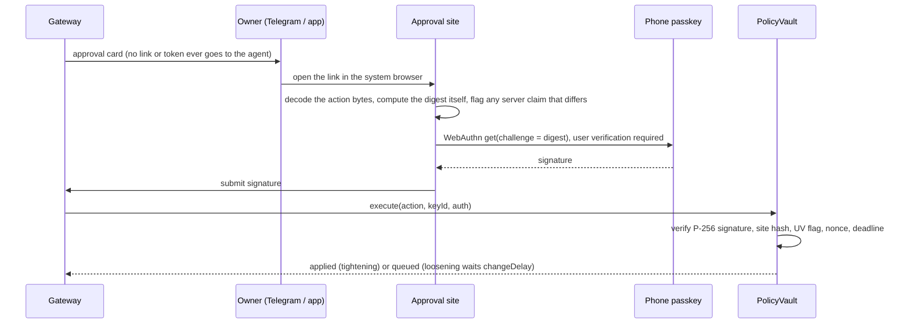

# Technical document

Nudge, FinTechathon 2026, Topic F (Nudge). Draft laid out for the official template; sections map one to one. Every number here comes from a test, an eval run or a Base Sepolia transaction in this repository.

## 1. Problem

AI assistants now act for people: they read bills, answer messages and are asked to pay. Today an assistant that can pay holds either a full key (a hot wallet) or a server-side spending limit that a stolen key or a compromised server ignores. Prompt injection makes this worse: any text the assistant reads (an email, a web page, a bill name) can carry an instruction, and no model reliably refuses every one.

Our answer: let any assistant pay, but only through a contract that enforces the owner's rules itself, so the worst case is a known, small number even when the assistant is fooled, its key is stolen, or our server is bypassed.

## 2. What the product does

- One personal finance view: accounts, statements, bills, safe-to-spend.
- An **Nudge wallet**: a `PolicyVault` contract per person on Base Sepolia holding a test stablecoin (tUSD, no value).
- Assistants connect: our own chat assistant (app and Telegram) and outside assistants such as Claude Code over MCP, each with its own key and limits.
- Inside its limits an assistant pays at once; above $5 the vault holds the payment for 2 minutes so the owner can cancel; above its limits the owner approves with a passkey on a phone.
- The owner can freeze any assistant, or the whole wallet, from chat, Telegram or the app. Tightening applies at once; loosening waits.

## 3. Architecture

| Part | Runs on | Job |
|---|---|---|
| `apps/web` | Vercel (Next.js) | Dashboard, onboarding, chat, proof page (vault record and worst-case exposure) |
| `apps/approve` | Vercel, separate origin (Vite) | The only place a passkey is created or signs; rebuilds the action from the signed bytes |
| `packages/backend` | Convex | Ledger and imports, the MCP gateway (`/mcp`), task lifecycle, relayer queues, chain reads and writes, Telegram |
| `packages/domain` | Shared TypeScript | Money, statement parsing, vault encoding, the signed digest, WebAuthn helpers |
| `contracts` | Base Sepolia | `PolicyVault` (v3), `VaultFactory`, `TestUSD` |

Live: dashboard https://nudge-wallet.vercel.app, approval site https://nudge-approve.vercel.app, v3 factory `0xF0D906bdec522087992EA711710Ee60F2a8DA95e`.

### 3.1 An outside assistant pays inside its limits

```mermaid
sequenceDiagram
  participant C as Claude (MCP client)
  participant G as Gateway (Convex /mcp)
  participant R as Relayer queue
  participant V as PolicyVault
  C->>G: propose_payment(contactId, amount, reason, requestId)
  G->>G: scope, frozen, per-payment, 24h cap, ceiling, protected, new contact, requestId
  G-->>C: submitted (taskId), never "paid"
  G->>R: agentPay task (agent's own sealed key)
  R->>R: sign, store raw tx and hash, then broadcast
  R->>V: agentPay(contactId, amount, paymentId, purposeHash)
  V->>V: same checks again, on-chain
  V-->>R: PaymentExecuted, or PaymentHeld, or PaymentRefused(code)
  R->>G: receipt decides: confirmed / held / refused; lost reply = unknown, reconciled by hash
  C->>G: get_task_status(taskId)
```

### 3.2 Above the limits: the owner approves on a phone



### 3.3 A lost broadcast or receipt

The relayer signs locally and stores the signed bytes, nonce and hash on the task before broadcasting. If the node's reply is lost, the task becomes `unknown` (never `failed`) and keeps its reservation. Reconciliation re-sends the same bytes every 30 seconds, which cannot pay twice. A release or finalize whose nonce another transaction took goes back to held or queued and is sent again. Callbacks that arrive after a task settled are recorded but never reopen it.

### 3.4 Mandates any party can verify (AP2)

AP2's IntentMandate, CartMandate and PaymentMandate are produced from the vault (`packages/domain/src/mandates.ts`) with AP2's own field names, and the proof sits beside them under `x-policyvault`. A verifier needs only a Base Sepolia node. It finds the transaction where the contract verified the owner's passkey (also when a loosening waited out the delay), checks the grant's limits, expiry and contacts against the vault, and says whether the grant is still in force. An assistant presents its intent mandate over MCP (`get_mandate`); each settled payment returns its payment mandate. In AP2 as designed, a payment network or a credential issuer vouches for the user's authorisation; here the contract that enforces it is the record.

### 3.5 Family guardian

An owner can name a guardian (a family member with their own account). The guardian sees held payments and assistant requests, never balances, gets an alert when a payment is held, and can stop it or freeze the assistants. Both are actions the vault's guardian role already allows, so a guardian can only tighten. Extra protection is one passkey approval that holds every assistant payment for 10 to 60 minutes.

## 4. Algorithms and invariants

**Agent payment checks** (`PolicyVault.agentPay`), in order. A failure emits `PaymentRefused` with a code and returns, so the refusal is itself on-chain evidence:

| Check | Code |
|---|---|
| registered, not frozen, vault not frozen | revert |
| agent not expired | 2001 |
| contact saved (one contact per address) and past its waiting period | 2010 / 2002 |
| payment id unused (agent and owner ids share one space) | 2007 |
| within the agent's per-payment limit | 2003 |
| agent's rolling 24-hour total within its cap | 2003 |
| all agents' rolling 24-hour total within the vault ceiling, counted when money leaves | 2004 |
| balance minus held minus amount stays at or above the protected amount | 2005 |
| per-contact daily cap across all agents | 2012 |

Five refusals in 24 hours freeze that agent. Above `holdAbove`, the payment is held for `holdFor`; anyone may release it after that unless the owner or guardian cancelled it, or the agent, contact or vault changed.

**Rolling window.** Each payment is stored as (time, amount) in a fixed ring; the 24-hour total sums slots newer than now minus 24 hours. There is no calendar reset to double-spend across.

**Owner action.** The passkey signs `keccak256(abi.encode(TYPEHASH, op, keccak256(data), nonce, deadline, chainId, vault))`. The contract verifies the WebAuthn assertion (OpenZeppelin `WebAuthn.verify`, P-256), the stored site hash and user verification. Loosening (a new or larger grant, a lower protected amount, a higher ceiling, shorter delays, unfreezing, adding or removing a passkey, withdrawing) is queued for `changeDelay`; tightening applies at once. Generations and epochs void a queued change when its target agent, contact or signing passkey is later revoked or tightened, so revocation is final.

**Invariants checked by stateful fuzzing** (13, `contracts/test/*Invariant*.t.sol`, 128 runs of up to 16,384 random calls each, including owner actions, policy changes, removals, withdrawals, freezes and a stolen key):

- the vault never goes below the protected amount through an agent payment or release;
- money only reaches saved contacts (or the owner by withdrawal); the attacker's balance stays 0;
- accepted agent requests in any 24 hours stay under the highest ceiling ever in force;
- `heldTotal` equals the sum of held payments and is always backed;
- no frozen, removed or unregistered agent moves money;
- no agent payment exceeds its per-payment limit;
- every token that leaves the vault is matched by an event.

Two planted bugs (frozen check removed; payment event removed) are each caught by these invariants.

## 5. Evaluation

| What | Result | Where |
|---|---|---|
| Contract tests (unit, fuzz, invariants, requirement tests) | 166 pass | `forge test` |
| Backend (convex-test): gateway decision matrix of 96 cases against a rules oracle, approvals, Telegram inbound, rate limits, settlement callbacks | 165 pass | `pnpm --filter @agent-wallet/backend test` |
| Same attacks against a hot wallet, a capped wallet and PolicyVault, stolen keys, server bypassed | PolicyVault loses $0 where the attacker needs a new address, a replay or a substituted approval; the capped wallet loses up to $242 | `evals/README.md` |
| Prompt injection, 54 cases (38 attacks, 12 hidden in the owner's own bills, contacts and categories), Claude Opus / Sonnet / Haiku over MCP, real vault per case | 0 of 38 attacks fooled any model; legitimate tasks 15 of 16 | `evals/README.md`, `evals/TASKS.md` |
| Same cases with a model scripted to obey every injection | 36 of 38 fooled, yet nothing reached an address that isn't a saved contact; worst single case $24.95 | `evals/results/agent-injection-obedient-summary.md` |
| 68 P0 attacks from our corpus | 63 automated, 19 with a Base Sepolia transaction | `evals/P0.md` |
| Every transaction cited in our docs | 82 of 82 rows match the chain | `scripts/verify-evidence.sh` |

## 6. Limits we state plainly

- A fooled assistant can still pay a saved contact inside its limits; limits bound the amount, not the purpose.
- The server keeps sealed agent keys; a full server compromise can spend inside each agent's limits, only to saved contacts.
- WebAuthn has no trusted display: a compromised approval page could show one action and sign another. The page is a separate origin with a strict CSP and rebuilds the display from the signed bytes; loosening still waits.
- Testnet and a valueless test token only. See `COMPLIANCE.md`.
